# Per-task sessions: design

- **Status:** draft 3, for review.
- **Base:** OpenRig `v0.7.20` (`6da7f832b`).
- **Related:** mvschwarz/openrig#27, "Context & Compaction", which asks for fresh sessions per ticket and better cache
  use.

**Conventions:**
- Paths: `d/` is `packages/daemon/src/`, `c/` is `packages/cli/src/`.
- Line numbers are at `6da7f832b` and move with every commit; function names are the stable reference.
- **In diagrams, dashed boxes are new code and solid boxes exist today.**
- `ID`, `K`, `K2` and similar are placeholders.

**Design decisions:**
1. **Keys are inherited.** A row created by a seat that is working on task K carries K unless told otherwise.
2. **No shared sessions on a per-task seat.** A keyless work row gets a generated key and a fresh session. Replies,
   handoffs and follow-ups in the same Slack thread carry that key back, so they land in the exact session.
3. **The cache window and map retention are set in the rig spec.** OpenRig applies them to the runtime, so nobody
   configures Claude or Codex separately.
4. **A keyed row is never worked in another task's session.** If a switch can't happen, the row waits and the reason is
   visible. If the task's session is gone, the task gets a fresh session and the seat is told how to recover.
5. **How a new task session starts is an option:** `agent_image` (fork the seat's own agent image, the one its
   existing `session_source` names) or `restart` (relaunch in place, blank). The default follows how the seat
   launches: `agent_image` on a seat with an image, `restart` otherwise. A task never picks an image and never changes
   the seat's.
6. **A person at the seat is protected like any managed input.** A switch goes through the same draft and typing
   guards as the compaction enforcer's `/compact`. There's no separate waiting period.
7. **Retention defaults to 28 days for both runtimes.** For Claude it's capped below Claude's own transcript cleanup.
8. **Workflow runs key their rows by the run** (`wf-INSTANCE`).
9. **Tasks are never closed, and retired map entries are never purged.** Revisit only if the map becomes a problem.
10. **Order is oldest first, with affinity.** When a seat goes idle, rows for its current task that are older than the
    oldest row waiting for another task go first. Then it switches straight away. There's no minimum stay.
11. **Switch errors are classified (§9.5).** Each known error gets its own handling. Unknown errors are tried once a
    minute, three tries in all, and then the operator is alerted.
12. **Pools are covered (§7.11).** In a seat pool, a task's row goes to the member that has the task's session
    loaded. If none does, any member can take it.
13. **`sessions:` can be set once for the whole rig,** and a seat can override it.

---

## 1. In one paragraph

A seat with `sessions.scope: per-task` keeps one native session per task (a Claude session id or a Codex thread id)
in a map. Every work row for such a seat carries a task key: explicit (`--task`), inherited from the sending seat's
current task or the handed-off row, taken from the Slack thread or workflow run, or generated when there's none.

- **Same task:** a row for the seat's current task is delivered as today.
- **Another task:** the wake stays `pending`. Once the seat is idle, a switcher takes the seat's lifecycle lock. It
  resumes that task's session (Claude: `/resume ID` typed in the pane; Codex: relaunch with `codex resume ID`), or
  starts a fresh one for a new task. It then releases the held wakes, re-checking each at write time so none lands in
  the wrong session.
- **Cache and retention:** OpenRig sets the spec's cache window in the seat's launch environment, and retires map
  entries before the runtime deletes the session.
- **Pools:** the map belongs to the pool, so a task follows its session from member to member.
- **Unchanged:** daemon notices (compaction restore, watchdog, stall alerts) carry no key and go to the seat's current
  session. Seats without `per-task` behave exactly as today.

---

## 2. Why this belongs in the daemon, not in a skill

OpenRig prefers guidance over code when an agent with today's commands could do the job. Here it can't:

- **The agent can't tell which session a wake should land in.** Wakes are typed into the pane by the daemon. By the
  time the agent reads one, it's already in whatever conversation is open.
- **Switching changes the process the agent runs in.** An agent can't safely relaunch or `/resume` itself mid-turn and
  then pick up the row afterwards.
- **Ordering and holding need the outbox.** The daemon already owns delivery, the per-seat lock, restore and the
  session registry. Holding a wake until a switch is done, and re-checking it at write time, is only possible there.
- **What a skill does cover:** how an agent passes `--task`, uses `--task new`, and recovers a task with
  `rig queue list --task`. That guidance ships with the feature.

---

## 3. Terms

| Term | Meaning here | Today's code |
|---|---|---|
| Seat / node | One agent in one tmux pane (`pod-member@rig`) | `nodes`, `bindings` |
| Row | A durable queue item | `queue_items` |
| Wake intent | The pending nudge that tells a seat a row is waiting | `outbox_entries` id `wake-intent-<qitem>` |
| Nudge | Text typed into the pane that points at the row. The row body is never typed. | `queue-nudge-text.ts:31`, `pane-envelope.ts:117` |
| Coalesced send | Several wakes to one seat typed as one nudge | `queue-repository.ts:1789` |
| Native session | The runtime's own conversation: a Claude session id or Codex thread id | `sessions.resume_token` |
| Occupancy / occupant generation | One launch of the runtime in the pane: a `sessions` row plus a generation id that hooks carry | `sessions`, `occupant_tenures` |
| Drain | `drainPendingWakeIntents`: send wakes that are pending and now eligible | `queue-repository.ts:1969` |
| Task key | New: names the task a row belongs to | none |
| Generated key | New: `t-` + ULID, made at row creation when no key exists | none |
| Group | New: the set of seats that share one map. A seat on its own is a group of one; a pool's group is its model seat plus its live slots. | `seat_pool_slots` |
| Map entry | New: (group, task key) → native session | none |
| Holder | New: the group member that has an entry's session loaded now. At most one per entry and one entry per member. | none |
| Parked | New: an entry nobody holds. Its session is on disk and can be resumed. | none |
| Current task | New: the task of the entry a seat holds | derived from the holder |
| Pristine session | New: the session a seat was freshly launched into, while still untouched. Defined precisely in §7.6. | derived |
| Switch / armed | New: moving a seat from one session to another. A switch is armed from the moment it's recorded until it's confirmed or abandoned. | none |
| Affinity | New: preferring the seat and session that already hold a row's task | none |
| Cache window | How long the provider keeps the conversation's prompt cache | runtime setting |
| Runtime lifetime | How long the runtime keeps a session resumable on disk | runtime behaviour |

A `sessions` row is one **occupancy**, not one conversation. Relaunch, restore, handover and runtime switch each
supersede it, and `resume_token` is a pointer that the SessionStart hook overwrites. That's why the map is keyed by
group and task, not by `sessions.id`.

---

## 4. How it works today

### 4.1 Row to pane

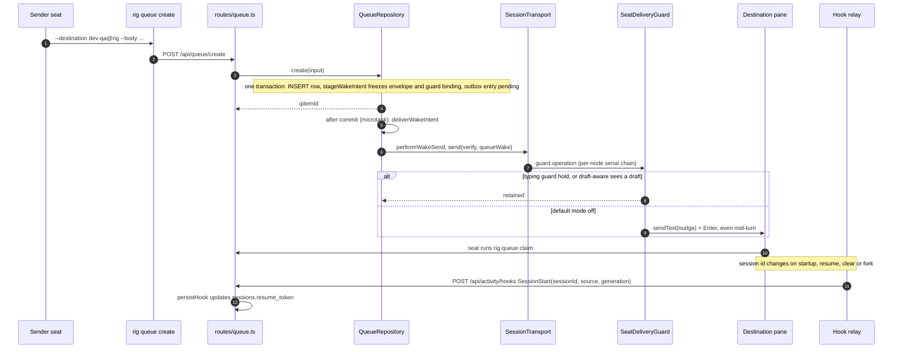

Facts the design depends on:

- **Wakes don't wait for idle.** The default typing guard (`off`) types even while a turn runs. `sendUnguarded`
  (`session-transport.ts:3453`, busy advisory at `:3865-3958`) only warns. The only refusal is an open prompt
  (`needs_input`).
- **There is already a pending gate.** `deliveryDrains.holds()` (`queue-repository.ts:1737-1738`) leaves an intent
  `pending` with no attempt spent. `drainPendingWakeIntents` (`:1969`) releases it at boot, when a drain ends and when a
  tmux server returns.
- **There is a per-seat lifecycle lock.** `SeatDeliveryGuard.lifecycle([nodeId])` (`seat-delivery-guard.ts:417`)
  queues every wake to that seat behind it. The compaction enforcer types `/compact` under it
  (`claude-compaction-enforcer.ts:1087`, `sendPreparedCompact:1792`).
- **Hooks report every session change.** `openrig-core/hooks/claude.json` registers SessionStart with no matcher. The
  path is `activity-relay.cjs` → `routes/activity.ts:postHook:409` → `persistHook:710` →
  `session-registry.ts:recordHookSessionIdentity:650` → `updateResumeToken:593`. Codex uses the same relay.
- **A hook write can't overwrite an operator-set token.** The ranks are scrape 0, adoption 1, hook 2, operator 3
  (`session-registry.ts:90-95`, `:603`).
- **Restore follows `resume_token`.** `rig up --existing` resumes the current row's `resume_token`
  (`existing-rig-restore.ts:32`, `rehydrate-eligibility.ts:20`).
- **The nudge is frozen at creation.** `stageWakeIntent` (`queue-repository.ts:1510`) renders the envelope inside the
  create transaction.
- **Daemon notices don't name a reliable sender.** For example, `compaction-restore-notice.ts:92` uses the seat's own
  session name. "Is this a work row?" therefore has to come from the entry point, not the sender (§7.2).

### 4.2 Corrections to the original spec

1. **Base commit:** this design starts at `v0.7.20`. The files the spec lists are identical at `44878ef0a`.
2. **Delivery files:** `queue-pickup.ts` only derives pickup receipts and stalls. Delivery is `queue-repository.ts` →
   `session-transport.ts` → `seat-delivery-guard.ts` / `draft-aware-delivery.ts`.
3. **Session-id recording:** session ids are recorded through `routes/activity.ts` into `session-registry.ts`.
   `routes/sessions.ts` holds the resume-token route and the node inventory.
4. **Compaction:** managed compaction is Claude-only. It's off by default; when on, it triggers at 80% by default.
5. **"Deliver" is a typed nudge,** and the seat claims the row. The daemon has no per-seat "next row".
6. **Reply:** there's no `rig queue reply`. Handoff copies tags, but `--tags` replaces the whole list, so the key needs
   to be a column.
7. **Resume flags:** the resume launch already rebuilds `--settings`, model, effort, MCP and `--agent`. Plugin dirs
   travel in the `CLAUDE_CODE_PLUGIN_DIRS` env.
8. **Field name:** `session_source:` already exists, so the new settings live in a `sessions:` block.
9. **Wrong issue reference:** `#3395` is about priority aging. Seat-pool "Piece 1" (the `pool:` block,
   mvschwarz/openrig#3480) has already shipped.
10. **Cache windows:** Claude's main conversation gets 1 h on a subscription and 5 min on an API key, and it can be set.
    Codex can't be set in 0.165.0 (Appendix B).

---

## 5. Design at a glance

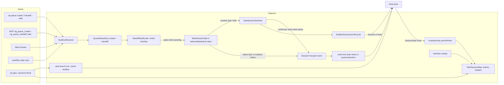

| Decision | Choice | Why |
|---|---|---|
| Configuration | `sessions:` block on the rig and on members: `scope`, `cache_ttl`, `retention_days`, `fresh_start` | One place (decisions 3 and 13) |
| Key storage | `queue_items.task_key` column | Tags are replaced by `--tags` on handoff. A column carries explicitly, like `return_route` (migration 172). |
| Keyless work rows | A generated `t-<ULID>` key, shown to the sender | Decision 2 |
| Map key | `(group_id, task_key)`, one holder at a time | `sessions` rows are superseded on every relaunch, and a pool shares a task's session across members |
| Where the hold happens | `deliverWakeIntent` `claim`, beside `deliveryDrains.holds` | No attempt spent. It survives a restart through the boot drain. |
| Correctness at write time | Each wake carries its expected task. `guard.operation` re-checks it under the per-seat lock. | A wake that passed the gate earlier can't land after a switch (§7.3) |
| Claude resume | `/resume ID` typed in the pane, confirmed by exact id. Relaunch `--resume ID` is the fallback. | Same process, flags and env. Proven in the spike (Appendix A). |
| Fresh session | Relaunch in place: Claude with a pre-generated `--session-id`, Codex plain, or a fork of the seat's own agent image. A pristine launch session is adopted instead. | `/clear` drops the startup guidance typed in at launch |
| Codex resume | Relaunch in place with `codex resume ID` | Codex's in-TUI `/resume` is a picker |
| Row shows session | `queue_items.task_session_ref` = map entry id | Native ids stay out of diagnostics (`daemon-http-clients.md:343`) |
| Before every resume | Preflight: the native file exists, nobody else holds the id, same runtime, cwd and home | Cheap checks that avoid most resume failures |

---

## 6. New API surface

### 6.1 Rig spec: the `sessions` block

```yaml
sessions:                       # rig-wide default (optional)
  scope: per-task
  cache_ttl: 1h
pods:
  - id: dev
    members:
      - id: review
        runtime: claude-code
        session_source:         # existing key: the seat launches as a fork of this image
          mode: agent_image
          ref: { kind: image_name, value: reviewer-primed, version: "2" }
        sessions:               # member override, key by key (optional)
          retention_days: 21    # fresh_start defaults to agent_image here: each task forks reviewer-primed v2
      - id: build
        runtime: claude-code    # no image: fresh_start defaults to restart
      - id: notes
        runtime: terminal       # not supported: the rig default skips it, with an advisory
```

| Key | Values | Applies to | Effect |
|---|---|---|---|
| `scope` | `shared` (default), `per-task` | `claude-code`, `codex` | Per-task switching. On a member's own block, an unsupported runtime is a validation error. From the rig-wide default, it's skipped with an advisory. |
| `cache_ttl` | `5m`, `1h` | any Claude seat, shared or per-task | Sets `CLAUDE_CODE_PROMPT_CACHE_TTL` in the launch env (§7.9). On Codex: an advisory, not applied. |
| `retention_days` | integer ≥ 1 | per-task seats | How long an unused entry stays resumable. Default and cap come from the runtime lifetime (§7.10). |
| `fresh_start` | `agent_image`, `restart`. Default: `agent_image` when the member has `session_source.mode: agent_image`, otherwise `restart`. | per-task seats | How a new task's session starts (§7.6). `agent_image` forks the image the seat's own `session_source` names, at its pinned version. `restart` gives a blank session even on a seat with an image. On a member's own block, `agent_image` without an image `session_source` is a validation error. From the rig-wide default, such a member gets `restart`, with an advisory. |

- **One image per seat.** There's no image key under `sessions:`. The image is the seat's `session_source`, which
  already exists (`rigspec-schema.ts:803`, stored as `nodes.session_source_json`). Changing it is what it is today:
  edit the spec, then relaunch the seat. A task arriving never changes it. A pool slot uses its model seat's
  `session_source`.

- **Validation:** `rigspec-schema.ts` adds `sessions` to `RIG_KEYS` (`:69`) and `MEMBER_KEYS` (`:74`), with value
  checks in `validateMember` (`:515`) following `restore_policy` (`:684`).
- **Older daemons** refuse the key (both key sets are strict), as they do `pool:`. `rig-spec.md` says so.
- **Inheritance:** a member's effective block is the rig default overlaid by its own block. Pool slots inherit the
  model seat's effective block.
- **Storage:** the effective block is stored as `nodes.session_policy` (JSON), through `NodeOptions` → `addNode`
  (`rig-repository.ts:660`). It's re-applied on `rig up --existing` (`rigspec-instantiator.ts:2684`), exported by
  `rigspec-exporter.ts`, and serialized by `rigspec-codec.ts:179`.

### 6.2 CLI

| Command | Change |
|---|---|
| `rig queue create --task KEY\|new` | `KEY` sets the key. `new` forces a fresh generated key, ignoring inheritance. With no flag, §7.2 decides. The output prints `task: KEY`, plus `(generated)` when it was. |
| `rig queue handoff ID --task KEY\|new` | With no flag, keeps the source row's key |
| `rig queue handoff-and-complete ID --task KEY\|new` | Same as `handoff` |
| `rig queue list --task KEY` | Lists every row of a task, oldest first. This is the recovery path when a task's session is lost. |
| `rig queue list`, `rig queue whoami` | On a per-task seat, rows of another task are marked `held for task K2` |
| `rig queue claim ID` | On a per-task seat, refused when the row belongs to another task (§7.8) |
| `rig queue show ID` | Adds `task:`, `session:` (opaque ref) and, while held, `held: REASON since T` |
| `rig seat sessions SEAT [--json] [--full]` | New. Lists the group's map: key, ref, state, holder, created, last used, cache warmth, retire reason. `--full` adds the native id. |
| `rig seat sessions SEAT --retry` | New. Clears an escalated switch, so it's tried again at the next idle. |
| `rig ps --nodes` | Human table: a `TASK` column. JSON: `sessionScope`, `currentTask`, `currentTaskSession` (ref), `switch` (state, attempts, last error). |

Key format: `^[A-Za-z0-9][A-Za-z0-9._:/-]{0,127}$`. The word `new` is reserved.

```text
$ rig seat sessions dev-review@my-rig
TASK            SESSION       STATE    HOLDER        LAST USED   CACHE         CREATED
* issue-412     ts_01JD2K9R   active   dev-review    2m ago      warm, 58m     1h ago
  t-01JD1P4QXK  ts_01JD1P4Q   active   (parked)      3h ago      cold          1d ago
  spike-acp     ts_01JC8M2T   retired  -             29d ago     -             35d ago   retention
  issue-377     ts_01JC2B7W   retired  -             2d ago      -             9d ago    expired (runtime deleted it)
```

### 6.3 HTTP

| Route | Change |
|---|---|
| `POST /api/queue/create` (`routes/queue.ts:710`) | Body `taskKey?: string \| "new"`. The response adds `taskKey` and `taskKeyGenerated`. |
| `POST /api/queue/:id/handoff` (`:1116`), `/handoff-and-complete` (`:1213`) | Body `taskKey?: string \| "new"`. Absent means inherit. |
| `POST /api/queue/:id/claim` (`:974`) | No new input. Stamps `task_session_ref`, and refuses a row of another task (§7.8). |
| `GET /api/queue/list?taskKey=` | Filters by task |
| `GET /api/seat/task-sessions/:seatRef` | New. `?full=1` adds native ids. Resolves the seat like `runtime-home` (`seat-lifecycle-service.ts:resolveSeat:2634`). |
| `POST /api/seat/task-sessions/:seatRef/retry` | New. Backs `--retry`. |
| `POST /api/seat/set-input-route/:seatRef` (`routes/seat.ts:44`) | Refuses `native` on a per-task seat (B6) |
| `GET /api/rigs/:rigId/nodes` (`routes/sessions.ts:158`) | Adds `sessionScope`, `currentTask`, `currentTaskSession`, `switch` |
| Cross-host forward (`routes/queue.ts:592-616`) | Carries `taskKey`. A peer without the feature ignores unknown fields, so the forwarder detects that by the missing `taskKey` in the response and adds an advisory (A7). |

### 6.4 MCP

`rig_queue_create` (`c/mcp-server.ts:1674`) and `rig_queue_handoff` (`:2671`) get an optional `task` parameter, and the
result returns the resolved key. The zod input schemas carry it, and `c/test/mcp-server.test.ts` covers it.

### 6.5 Database: migration `179_task_sessions.ts`

```sql
ALTER TABLE nodes ADD COLUMN session_policy TEXT;           -- JSON {scope, cache_ttl, retention_days, fresh_start}, fresh_start resolved
ALTER TABLE queue_items ADD COLUMN task_key TEXT;
ALTER TABLE queue_items ADD COLUMN task_key_origin TEXT;    -- explicit | inherited | handoff | thread | workflow | generated
ALTER TABLE queue_items ADD COLUMN task_session_ref TEXT;   -- seat_task_sessions.id that worked the row

CREATE TABLE seat_task_sessions (
  id                TEXT PRIMARY KEY,                       -- ULID, shown as the session ref
  group_id          TEXT NOT NULL REFERENCES nodes(id) ON DELETE CASCADE,  -- the seat, or the pool's model seat
  task_key          TEXT NOT NULL,
  holder_node_id    TEXT REFERENCES nodes(id) ON DELETE SET NULL,          -- member on it now; NULL = parked
  last_node_id      TEXT REFERENCES nodes(id) ON DELETE SET NULL,          -- member that last held it
  runtime           TEXT NOT NULL,                          -- claude-code | codex
  native_session_id TEXT,                                   -- NULL until known (Codex fresh)
  launch_cwd        TEXT NOT NULL,                          -- Claude transcripts are per folder
  runtime_home      TEXT,                                   -- CLAUDE_CONFIG_DIR / CODEX_HOME in force
  state             TEXT NOT NULL DEFAULT 'pending',        -- pending (fresh launch not yet confirmed) | active | retired
  created_at        TEXT NOT NULL,
  last_used_at      TEXT NOT NULL,
  last_cache_ttl    TEXT,                                   -- effective window last observed
  last_resume_cost  TEXT,                                   -- context_tokens and estimated_cache_write_usd of the last resume
  retired_at        TEXT,
  retired_reason    TEXT                                    -- see 9.9
);
CREATE UNIQUE INDEX seat_task_sessions_active
  ON seat_task_sessions(group_id, task_key) WHERE state IN ('pending', 'active');
CREATE UNIQUE INDEX seat_task_sessions_holder
  ON seat_task_sessions(holder_node_id) WHERE holder_node_id IS NOT NULL;   -- one loaded task per member
CREATE INDEX queue_items_task_key ON queue_items(task_key) WHERE task_key IS NOT NULL;

CREATE TABLE seat_task_switches (                           -- at most one switch per seat
  node_id         TEXT PRIMARY KEY REFERENCES nodes(id) ON DELETE CASCADE,
  task_key        TEXT NOT NULL,
  entry_id        TEXT NOT NULL REFERENCES seat_task_sessions(id),
  mechanism       TEXT NOT NULL,                            -- adopt | claude_resume_typed | claude_resume_relaunch | claude_fresh_relaunch | claude_fresh_image | codex_resume_relaunch | codex_fresh_relaunch | codex_fresh_image
  phase           TEXT NOT NULL,                            -- acting | retrying | escalated
  generation_uuid TEXT,                                     -- occupant generation the hook must come from
  expected_native_id TEXT,                                  -- exact id that confirms a typed resume or a fresh launch
  armed_at        TEXT NOT NULL,
  attempts        INTEGER NOT NULL DEFAULT 0,
  last_error      TEXT,                                     -- error class and signal (9.5)
  next_attempt_at TEXT
);
```

- **Current task:** there's no `current_task_key` column. A seat's current task is the entry whose `holder_node_id` is
  that seat.
- **Switching away parks the outgoing entry:** `holder_node_id` NULL, `last_node_id` set to the seat.
- **Registration:** `ALL_MIGRATIONS` (`db/all-migrations.ts`) and `migrationsForFullTestDb`
  (`packages/daemon/test/helpers/test-app.ts:187`).
- **Number:** 179 is next. Parallel PRs often collide on the number (`arteries.md:43`), so check before merging.

### 6.6 Nudge text

The wake envelope is frozen at creation. It now freezes only a `task K` line. The session status is rendered when held
wakes are rebound after a switch (§7.6), since it's known only then. It's one of:

- `task issue-412 · session resumed`
- `task issue-412 · new session`
- `task issue-412 · new session (previous one unavailable: expired) · recover with: rig queue list --task issue-412`

---

## 7. How it works

### 7.1 Seat states

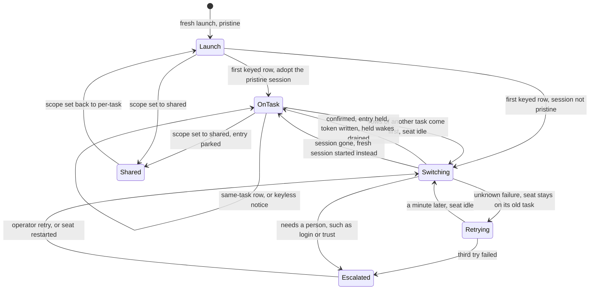

- **While `Retrying` or `Escalated`,** the seat is still on its old task, so rows for that task keep flowing. Only rows
  of the task it failed to switch to wait.
- **In `Shared`,** the gate is off and keys are still stored. Hook rule 3 (§7.7) stops rotating entries.

### 7.2 How a row gets its key

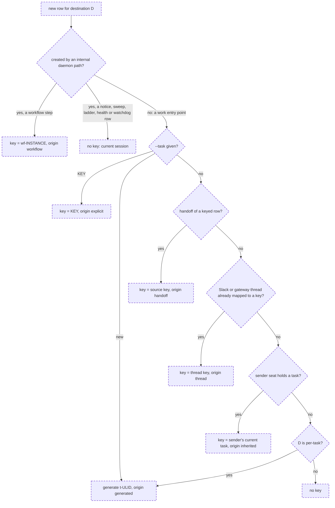

- **Work entry points:**
  - `POST /api/queue/create` (CLI, MCP, ACP, stream consumer, cross-host receive)
  - Slack and gateway requests from a person
  - Handoffs
- **Internal paths:** every other daemon creator (notices, stuck sweep, wake ladder, health, watchdog, mission
  control) passes no key. Their rows reach whatever session the seat is on, which is where a notice about the seat
  belongs. The entry-point test comes first, so a notice that names the seat itself as its sender can't inherit a key.
- **Slack threads:** a person's first request in a Slack thread gets a key (generated if needed), and the thread is
  mapped to it alongside the existing thread-to-seat map (`d/domain/gateway/slack/thread-seat-map.ts`, migration 072).
  Later messages in that thread carry the same key, so a follow-up continues the task's session instead of starting
  an empty one.
- **Generated keys loop back:**

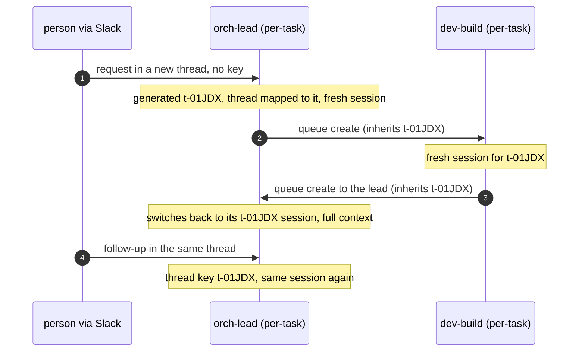

- **Direct terminal messages:** `rig send` and `rig broadcast` type into the pane without a row, so they land in
  whatever session is current. That's by design: they're not queue work.

### 7.3 Delivery decision

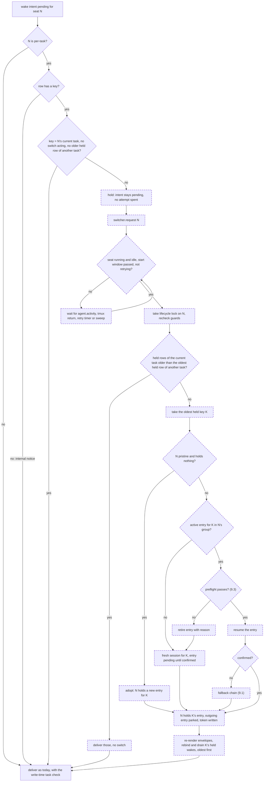

**The write-time task check closes a race.** A wake for task K can pass the gate while K is current and then wait in
the seat's serial send chain (`guard.operation`) behind a switch to K2. A typed resume keeps the pane and occupant, so
today's frozen-binding check (`guard_target_changed`, `session-transport.ts:3124`) wouldn't catch it. So:
- Every wake for a per-task seat freezes its expected task key in its `guard_binding`.
- `guard.operation`, under the per-seat lock, compares it with the seat's current task before writing.
- On a mismatch, the wake goes back to `pending` and held. It's not a failure, and no attempt is spent.
- Wakes released later by the typing guard pass the same check.

### 7.4 Order and affinity

When a seat goes idle with held rows, there are two steps:
1. **Affinity:** held rows of the seat's current task that are **older than the oldest held row of another task** go
   out first, in one coalesced send, with no switch.
2. **Switch:** otherwise, the seat switches straight away to the task of the oldest held row, and all of that task's
   held rows go out together.

The gate applies the same order to new rows. A row for the current task passes at once only if no older row of another
task is waiting. Otherwise it's held and takes its turn.

This keeps the oldest-first rule the queue already has. It also keeps affinity's benefit, since earlier rows of the
same task are taken without a switch. A steady stream of new rows for the current task can't starve another task.

**There's no minimum stay. The turn boundary replaces it.** A seat isn't switched between a delivery and the end of
the turn that delivery started, so it always gets to read what was just delivered. Only a wake the transport verified
as typed counts as a delivery. If no turn starts within the start window (30 s, as long as the existing readiness
wait), the boundary counts as passed. A wake lost on the way can't strand the seat.

If the turn ends without claiming the row, the row doesn't pin the seat. The wake ladder re-wakes it later, and
affinity brings the seat back to the task then.

### 7.5 What "idle" means

All of these must hold, read under the lifecycle lock just before acting:

| Check | Source today |
|---|---|
| The pane is alive and the seat is running | Binding and sessions status, `rig ps` liveness |
| No turn running | `hookOrPaneActivity` (`startup.ts:721-726`), `classifySendReadiness` (`session-transport.ts:4484`) |
| No open prompt (`needs_input`) | Same readiness classification |
| Draft and typing guards | The same pre-input refusals as `/compact` (`draft_input_busy`, `draft_input_unknown`, `draft_input_changed`, `pane_in_mode`; `claude-compaction-enforcer.ts:684`), under the seat's typing-guard mode and `transport.draft_delivery`. A relaunch runs the same check before it stops the process. |
| Not holding input | `holdsInput` / typing-guard hold |
| No delivery drain | `deliveryDrains.holds()` |
| No other lifecycle work | The lock itself, which covers compaction, handover, restart and provider switch |
| Turn boundary | §7.4 |

**When it's checked again:**
- On each `agent.activity` event, from a new branch in `retryPromptWakes` (`startup.ts:728`)
- When the seat's tmux server returns
- When the one-minute retry timer fires
- By the stuck sweep (300 s), as a backstop

### 7.6 Switch mechanisms

| Runtime | Resume an entry | Start fresh: `restart` | Start fresh: `agent_image` |
|---|---|---|---|
| Claude | **Typed:** `/resume ID` via `SessionTransport.send` under the lock, with the enforcer's options (`allowDraftWhileIdle: false`, `beforeWrite`, `waitForIdleMs`). Confirmed only by SessionStart `source=resume` carrying **exactly** ID, from this generation, after `armed_at`. It proceeds the moment the hook arrives (about 4 s in the spike), and 20 s is the ceiling. **Fallback:** relaunch in place with `--resume ID`, the provider-switch path (`d/domain/provider/claude-seat-switch.ts`, `relaunchInPane` call at `:145`, `restore-orchestrator.ts:launchSingleNode:728`). | Relaunch in place with a pre-generated `--session-id` (`claude-code-adapter.ts:499`). The full startup replays the seat's guidance. Candidate path: handover `freshInPlace` (`successor-session-launcher.ts:496`). | Relaunch in place as a fork of the seat's image: `claude --resume IMAGE_ID --fork-session --session-id NEW`, the fork branch at `claude-code-adapter.ts:461-496`. `IMAGE_ID` is the image's `sourceResumeToken`, resolved from `nodes.session_source_json` by name and version exactly as at launch (`rigspec-instantiator.ts:2853`). The image stays untouched. |
| Codex | **Relaunch in place:** `CodexInPlaceRestart` (`seat-restart-in-place.ts:213`, `execute:246`) generalised to take a target id, using its shell-backed path, which keeps the seat env. `codex resume ID` keeps the id. | Relaunch in place without resume. The id arrives with the SessionStart hook. | Codex's native fork of the image thread (`agent-images/resume-token-discovery.ts`) |
| Either | **Adopt:** when the seat is on its pristine session and holds nothing, that session becomes the task's. No relaunch. Only when the pristine session started the way `fresh_start` would start one: an image fork for `agent_image`, a plain launch for `restart`. | | |

**Pristine, precisely:** the seat's current occupancy was launched fresh (or as a fork of its image) by OpenRig and
confirmed by SessionStart with the pre-generated id. Since then, no turn has run other than the startup sequence, and
no row has been claimed by its generation. A person typing into it starts a turn, so the session is no longer pristine.

**Why fresh isn't `/clear`:**
- A seat's startup sends `send_text` files and `after_ready` actions as conversation input
  (`startup-orchestrator.ts:509-522`, `:614`, `:653`), and `/clear` drops them.
- A relaunch costs a new occupancy and about 5–15 s (bounded by the code, not measured). In return, the session
  starts like any fresh seat, and its id is known in advance.

**Costs to state:**
- **Typed resume and lineage:** after a typed `/resume`, the argv-based lineage verdict is "unknown" for the rest of
  the occupancy (`native-process-lineage.ts:1112`), the same as after any `/clear` today. The switcher records the
  confirmed switch as rotation evidence (the switch row's exact id and generation), so lineage can read it as a known
  rotation. Without that change, strict identity proofs would refuse on that seat until its next relaunch.
- **Codex in-place restart:** it sends TERM, then KILL after 3 s, and its own notes list "conversation saved" as not
  verified. The switch runs only at idle, after the turn has ended and been written, which keeps the risk small. It's
  still stated in the PR. Its refusals (`resume_binding_unverified`, `pane_shape_unknown`) are classified as
  needs-a-person (§9.5).

**After any relaunch,** held wakes for the seat have a frozen `guard_binding` (pane, occupant) that no longer matches.
The drain step rebinds the wakes the gate held, extending the rebind `deliverWakeIntent` already does for pre-input
failures (`queue-repository.ts:1739-1742`, `bindFirstTarget:1706`), and renders their session line (§6.6). Only wakes
that were never attempted are rebound.

### 7.7 Identity bookkeeping

**Invariant:** for a per-task seat holding task K's entry, `sessions.resume_token` of its current row equals the
entry's `native_session_id`. Restore already follows `resume_token`, so after a restart the seat comes back on its
current task's session with no change to restore.

On confirm, the switcher writes `resume_token` itself, with a new provenance `switch` ranked equal to `operator`. A
token an operator set earlier can't block the invariant.

`persistHook` (`routes/activity.ts:710`) calls `TaskSessionMap.onSessionIdentity(nodeId, sessionId, source,
generation)`, but only when the hook's token write was persisted:

1. **A switch is armed, and the hook matches it:** expected generation, after `armed_at`, and for a typed resume or a
   fresh launch the **exact** expected id. Confirm the switch. A relaunch resume may report a different id only with
   the launched-process proof `recordHookSessionIdentity` already records (`session-registry.ts:640-648`). A child
   `claude -p --resume` in the seat's environment can't confirm.
2. **A switch is armed, but the hook is `clear`, `fork` or another id:** a person or a child process intervened. Abandon
   the switch, apply rule 3, and leave the held rows held to be evaluated again.
3. **The seat holds an entry:** if the new id is another active entry's in the group, the seat now holds that entry
   and the old one is parked; a person resumed another task. Otherwise the held entry is pointed at the new id
   (rotation: a person's `/clear`, a handover, `--fresh`).
4. **The seat holds nothing,** or its scope is `shared`: nothing.

### 7.8 Claim and the row's session

- **Stamp:** at claim (`routes/queue.ts:974` → `QueueRepository.claim:3416`), a keyed row claimed by a per-task seat
  gets `task_session_ref` = the held entry's id, and the entry's `last_used_at` is touched.
- **Refusal:** a per-task seat can't claim a row of another task. The refusal is `row_held_for_other_task`, and it
  names the task and says the row will be delivered in that task's session.
  - **The concrete case** (what CONTRIBUTING asks for): seats read their inbox with `rig queue whoami` or `list` and
    may claim any pending row. Without the refusal, K2's work would be done in K's session, the exact pollution this
    feature removes. That breaks decision 4.
  - **The cost:** an agent occasionally has to wait for the nudge instead of claiming early.
- **Visibility:** `whoami` and `list` mark such rows `held for task K2`, and the nudge names the row or rows to claim.
- **Keyless rows** (notices) can be claimed at any time, as today.

### 7.9 The cache window from the spec

| `cache_ttl` | Claude seat | Codex seat |
|---|---|---|
| unset | Claude's default: 1 h for the main conversation on a subscription within plan usage; 5 min on an API key, usage credits or Bedrock/Vertex | Provider default: in-memory (about 5–10 min, up to 1 h) on older models; 24 h for non-ZDR orgs on the gpt-5.5 family; 30 min on gpt-5.6 and later |
| `5m` | `CLAUDE_CODE_PROMPT_CACHE_TTL=5m` in the seat launch env | Advisory: not applied |
| `1h` | `CLAUDE_CODE_PROMPT_CACHE_TTL=1h`. On an API key, a 1 h cache write costs 2× base input versus 1.25× for 5 min. | Advisory: not applied |

- **How it's applied:** through the seat launch environment (`seatLaunchEnvironment`, the same channel as
  `CLAUDE_CODE_PLUGIN_DIRS`), on every fresh launch, restore and relaunch. A typed `/resume` keeps the process, so the
  env stays in force.
- **Precedence:** the env var beats a `promptCacheTtl` a person has in their own settings. `FORCE_PROMPT_CACHING_5M`
  and managed settings still win, so OpenRig reports the **effective** window, not the configured one.
- **Warmth, Claude:** the status-line JSON carries `prompt_cache.{warm, ttl, expires_at, hit_ratio}` for the current
  session (Claude Code ≥ 2.1.251). The status-line collector records it per seat. A SessionStart on resume carries
  `prompt_cache_likely_expired`, `context_tokens` and `estimated_cache_write_usd`, which the entry keeps as
  `last_resume_cost`.
- **Warmth, Codex:** cached tokens per turn are in the rollout's `token_count` events.
- **Parked entries:** warmth is estimated as `last_used_at + last_cache_ttl`.
- **When Codex exposes a setting** (an internal per-turn TTL landed after 0.165.0 in openai/codex#59480, not
  configurable yet), `cache_ttl` maps to it.

### 7.10 Retention, aligned with the runtimes

| Runtime | How long a session stays resumable | Source |
|---|---|---|
| Claude Code | Deleted after `cleanupPeriodDays` (default 30, minimum 1). A background sweep after any Claude process starts covers every project under the config dir. `claude purge` also deletes. | Claude Code docs: settings, `.claude` directory |
| Codex | Never deleted by age. Only `codex delete` / `/delete` removes a thread. Archiving hides it from lookup; compression keeps it readable. | openai/codex `rollout/src/compression.rs`, openai/codex#24948 |

- **Default and cap:** let `L` be the runtime lifetime: Claude's effective `cleanupPeriodDays` for the seat's config
  dir, read from user and managed settings (30 by default).
  - `retention_days` defaults to 28. For Claude it's `L − 2` when that's lower.
  - A configured value above `L − 1` is capped at `L − 1`, with an advisory at `rig up`. Codex has no `L`, so there's no
    cap.
- **Why OpenRig doesn't raise `cleanupPeriodDays`:** the sweep is global. Any Claude process on the machine deletes
  with its own value, so a per-seat setting can't protect the transcripts. To keep Claude task sessions longer than 30
  days, raise `cleanupPeriodDays` in your user settings. This is the one runtime setting OpenRig can't own, and the
  `rig up` advisory says so.
- **The sweep:** daily, next to the existing retention sweep (`d/index.ts:152`). It retires active entries whose
  `last_used_at` is older than `retention_days`, except held entries and entries with a switch armed. Retired rows are
  kept (decision 9).
- **Retention is a promise of attempt, not of success.** Preflight (§9.3) checks the native file before every resume,
  so a session the runtime deleted early is caught without a failed resume.

### 7.11 Seat pools: task affinity across the pool

A seat pool (`pool:` on a member, shipped in 0.7.20 as stored-only) is the model seat plus clones the pool job adds
while its work waits. Each clone is a node in `seat_pool_slots` (`model_node_id`, `node_id`, `phase` = adding, live,
draining or drained). Rows are addressed to the model seat, and the pool job moves waiting rows to clones.
Per-task sessions work across the whole pool:

- **The group** is the model seat plus its `live` slots. The map entry belongs to the group, and one member holds it
  at a time.
- **Routing** is one function, `TaskAffinityRouter.chooseMember(row, group)`, called when a row is created for the
  model seat and whenever the pool job considers moving a row:

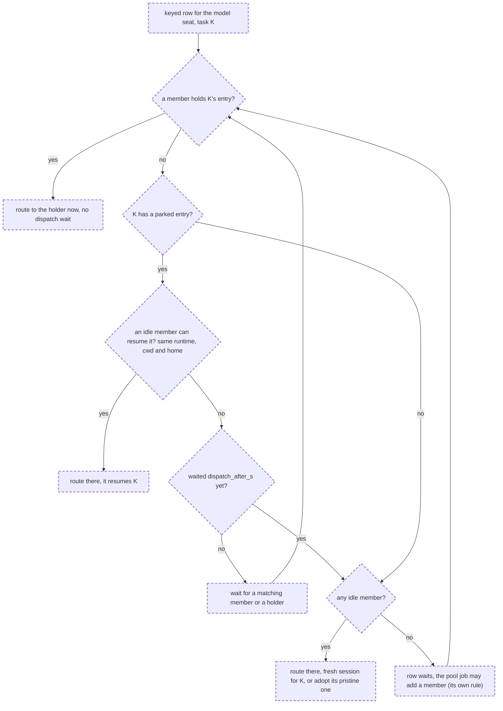

1. **The holder wins.** If a member has task K loaded, the row goes there at once, even if that member is busy. It's
   delivered by the single-seat rules. Affinity routing skips `dispatch_after_s`, because this is the best place for
   the row.
2. **Resume where possible.** If K's entry is parked, an idle member that can resume it takes the row: same runtime,
   same cwd (Claude transcripts are per folder), same runtime home. With a shared pool folder (a `cwd_template`
   without `{slot}`), every member qualifies. With one folder per slot, only the slot that last held K does.
3. **Patience, then anyone.** If no matching member is idle, the row waits up to the pool's `dispatch_after_s` for
   one. After that, any idle member takes it with a fresh session. The old entry is retired as `moved`, and the nudge
   carries the recovery hint.
4. **Nobody idle.** The row waits, and the pool job adds a member by its own rule. A new member adopts its pristine
   launch session.

**How this fits the rest of the pool:**
- **`dispatch_tag`:** it still decides which rows the pool may move at all. The router chooses among members only for
  rows the pool may move. Rows the pool may not move stay on the model seat, and the single-seat rules apply there.
- **Draining:** the job doesn't drain a member that holds an entry with held rows. When it drains a member, that
  member's entries become parked.
- **Adding:** a new member is never handed an entry another member holds. Preflight C7 enforces this.
- **Until the pool job is armed,** the group is just the model seat, and the router always returns it.

**Keyless rows:** internal notices go to the member they name. Keyless work rows get a generated key first (§7.2),
then go through the router.

---

## 8. Main flows

### 8.1 New key: a fresh session for the task

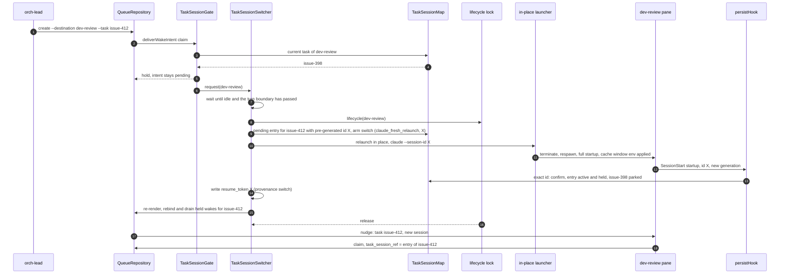

The old session (`issue-398`) isn't touched. The runtime keeps it on disk, and its entry is parked.

### 8.2 Known key: resume the task's session

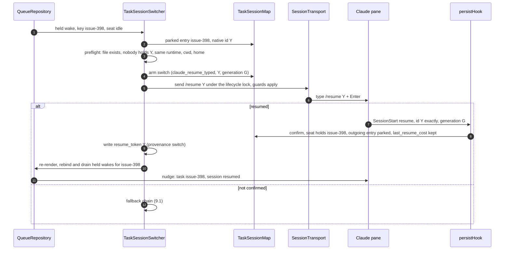

### 8.3 Other normal flows

| Flow | What happens |
|---|---|
| Same task as the current one, nothing older waiting | The gate passes it, and delivery is as today. The write-time check confirms the task. |
| Keyless internal notice | Delivered to the current session as today |
| Several tasks waiting | §7.4: older rows of the current task first, then a switch to the oldest waiting task |
| Two seats, one key | Seats in different groups (such as `dev-build` and `dev-review`) keep separate entries and sessions. Members of one pool share one entry, held by one member at a time. |
| Handoff | `handoffWithin:2830` / `handoffAndComplete:3018` copy `task_key` in the same transaction, next to `persistReturnRoute`. The receiver switches to its own entry for K. |
| Workflow run | Every step row of one run carries `wf-INSTANCE`. A review → build → review loop resumes the same sessions on each pass. |
| First keyed row after launch | The pristine launch session is adopted. No relaunch. |
| Restart or reboot | `rig up --existing` follows `resume_token`, which §7.7 keeps equal to the held entry's id |

---

## 9. Failure and edge cases

The rules throughout: **never work a keyed row in another task's session, never drop a row, and always leave a
visible reason.** The test ids map to §12.

### 9.1 When a resume doesn't work: the fallback chain

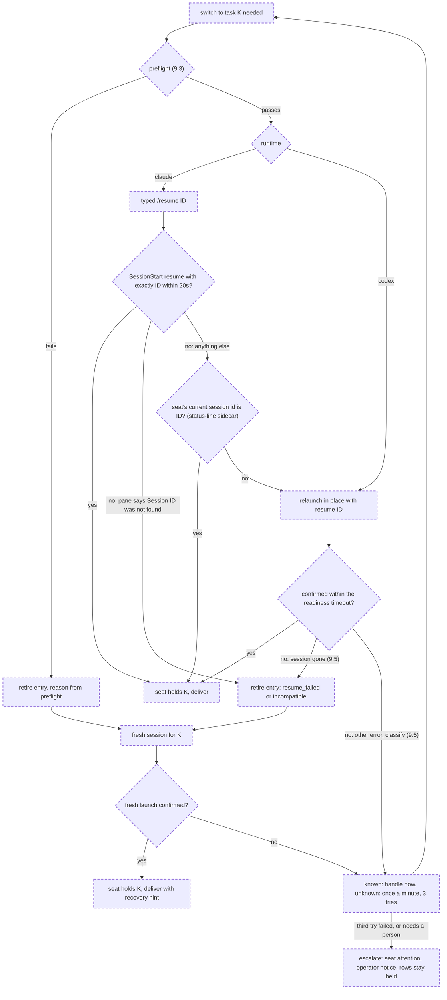

There are two kinds of failure, handled differently:
- **The session can't be resumed** (gone, refused, incompatible). Starting fresh is correct. The task continues in a new
  session, and the nudge tells the seat to rebuild context with `rig queue list --task K`.
- **The seat can't be switched** (a launch, pane or login problem). Starting fresh wouldn't help, because the launch
  itself is broken. The seat stays on its old task, its rows keep flowing, and the other task's rows wait until the
  switch succeeds or a person steps in.

### 9.2 Creating the row

| # | Situation | Detected by | Action | Seat / person sees |
|---|---|---|---|---|
| A1 | Malformed key | Route validation | Refused, 400 `task_key_invalid` | CLI error with the format |
| A2 | Explicit key to a seat that isn't per-task | No per-task policy | Stored, no switching | CLI advisory: `dev-qa isn't per-task; key stored only` |
| A3 | Keyless work row to a per-task seat | §7.2 | Generated `t-ULID` | CLI and MCP print it; the nudge shows it |
| A4 | Follow-up without the key, outside a mapped thread | Same as A3 | A new task, so a new session | The sender sees a new key and can resend with `--task` |
| A5 | Sender is on K, but the row is for an unrelated job | Inheritance | Carries K | The sender uses `--task new` or `--task OTHER`. The nudge always shows the key. |
| A6 | Handoff of a keyless row (created before the feature) | No source key | Falls through to thread, inheritance, then generation | — |
| A7 | Cross-host forward to a peer without the feature | No `taskKey` echoed in the peer's response | Advisory on the create response | `task key not supported by HOST; dropped` |
| A8 | Destination is a hosted seat, a human or a gateway | Destination class | Key stored, not used | — |
| A9 | Internal daemon notice | Not a work entry point (checked first) | No key, current session | As today |

### 9.3 Before switching: holding and preflight

| # | Situation | Detected by | Action | Seat / person sees |
|---|---|---|---|---|
| B1 | Seat not running (detached, stopped, exited, usage-limit wait) | Liveness, activity | Hold. No switch attempt. Re-evaluated when the seat comes back (boot drain, tmux return, `rig up --existing`). | `held: seat not running` |
| B2 | Delivery drain active | `deliveryDrains.holds` | The drain wins. Released at the drain's END. | As today |
| B3 | Seat never idle: a long turn, an open prompt or an abandoned draft | Idle check | Keep holding. After the stall threshold, `rig ps` shows attention and the stuck sweep escalates with the hold reason. | `held: waiting for idle since T` |
| B4 | The stuck sweep or wake ladder re-wakes a held row | Gate | Held again. It never types into the wrong session. | One escalation, not a loop |
| B5 | Lifecycle lock busy (compaction, handover, restart) | The lock | Waits in line | — |
| B6 | Seat uses native (hook-bridge) input, where wakes are deposited at the turn boundary | `nodes.input_route` = `native` | `rig up` refuses `scope: per-task` on such a seat, and `set-input-route native` refuses a per-task seat. Concrete case: a switch can't run at a turn boundary inside a hook. | The refusal names the conflict |
| C1 | No active entry for K | Map | Fresh session for K | `new session` |
| C2 | Native file gone (Claude `cleanupPeriodDays`, `claude purge`, `codex delete`) | Claude: `RUNTIME_HOME/projects/SLUG/ID.jsonl`. Codex: lookup by id (`.jsonl`, `.jsonl.zst`). | Retire `expired`, fresh | `new session (previous one unavailable: expired)` + recovery hint |
| C3 | Codex thread archived | Only under `archived_sessions/` | Retire `archived`, fresh. Never unarchive on the person's behalf. | Same, `archived` |
| C4 | The seat's cwd differs from the entry's (Claude transcripts are per folder) | `launch_cwd` | Retire `cwd_changed`, fresh. In a pool, the router prefers a member whose cwd matches. | Same, `cwd_changed` |
| C5 | Runtime home or account changed | `runtime_home` | Retire `home_changed`, fresh | Same |
| C6 | Runtime changed (Claude ↔ Codex) | `runtime` | Retire `runtime_changed` (every entry of the old runtime), fresh | Same |
| C7 | The native id is any other node's current `resume_token`, or an entry another member holds | Preflight query | Never resume it, because two processes on one session lose messages (spike step 6). Retire `held_elsewhere`, fresh. | Same, `held_elsewhere` |
| C8 | Entry retired by the sweep while a row waited | Map | Fresh | `new session (… retention)` |
| C9 | `fresh_start: agent_image`, but the seat's image was removed, retired or its session is gone since the seat launched | Preflight on the image | This task starts with `restart` instead. Nothing is retired. | `new session (agent image unavailable: REASON)` |

### 9.4 Switching: act and confirm

| # | Situation | Detected by | Action | Seat / person sees |
|---|---|---|---|---|
| D1 | Typed `/resume ID` opened the picker (not seen in the spike with an id, kept as a guard) | `currentClaudeResumePicker` (`native-resume-probe.ts:787`) | Escape, then relaunch | — |
| D2 | Typed resume says the session isn't there | Pane text `Session <ID> was not found.` (spike step 4). The current session keeps running. | Retire `resume_failed`, fresh. A relaunch wouldn't find it either. | Recovery hint |
| D3 | No hook in 20 s, but the seat's current session id is the target | The status-line sidecar and session files (`resume-token-capture.ts`). Only as fresh as Claude's last status-line render. | Confirm (hook lost) | — |
| D4 | Relaunch: the runtime reports the session isn't there | Claude `No conversation found with session ID: <ID>`, exit 1. Codex `No saved session found with ID <ID>`. | Retire `resume_failed`, fresh | Recovery hint |
| D5 | Relaunch: incompatible | Codex `modelProviderMismatch`, `invalid_encrypted_content`; a transcript-format change after a runtime upgrade | Retire `incompatible`, fresh | Recovery hint |
| D6 | Process won't exit, or the pane is dead | `pane-cutover.ts` TERM → KILL → respawn | Respawn once, straight away. If that fails, it's an unknown error (§9.5). | `rig ps`: `switch failing (try n/3)` |
| D7 | Readiness timeout (30 s default) | `waitForReady` | Check the hook or the sidecar. If the session is up, confirm. Otherwise classify the pane (§9.5). | Same |
| D8 | Fresh relaunch: startup guidance failed | `startup_status` | As for any fresh launch today: seat attention. The pending entry stays pending, and rows stay held until startup succeeds. | Startup attention |
| D9 | Usage limit at relaunch | The usage-limit state (`activity-taxonomy.ts`), and the 0.7.20 wake retry at the stated reset | Wait for the reset (Claude states one; Codex keeps its ordinary retry). Not a try. | `held: usage limit` |
| D10 | A person starts typing between the idle check and the write | `beforeWrite` | Abort, and retry at the next idle. Not a try. | — |
| D11 | Third try failed, or a needs-a-person error | `attempts`, error class | Escalate: seat attention plus an operator notice naming the error, with the last pane capture. Rows stay held. `rig seat sessions --retry` or a seat restart clears it. Concrete case for the new notice: a seat that can't switch silently holds a task's rows. | Notice to the operator |
| D12 | A fresh launch fails before confirming | No confirming hook, error class | The pending entry is deleted. It never becomes an active entry with no transcript. | — |
| E1 | Typed resume: the hook reports a different id | Rule 1 (exact id) | Not a confirmation. Abandon the switch, then apply rule 2. | — |
| E2 | `source=clear` or `fork` while armed (a person or a child process) | Rule 2 | Abandon the switch, apply rule 3, re-evaluate | — |
| E3 | Late hook from the old generation after a fallback relaunch | The existing earlier-generation refusal (`activity.ts:660`) | Ignored | — |
| E4 | Hook sent while the daemon was down | Boot reconciliation (§9.10) | Read the seat's current session id, then confirm or abandon | — |
| E5 | Resumed with the cache cold (`prompt_cache_likely_expired`) | Hook field | Record it, with `last_resume_cost` | `rig seat sessions`: `cold resume` |

### 9.5 Switch errors, classified

Every failed act is read from the pane, the exit or the hook, and sorted into one of five classes. Only the last is
tried again without knowing why: an unknown failure rarely clears by itself, so three tries a minute apart cover a blip
such as a slow start, and then a person looks.

| Class | Signals (existing detector where there is one) | Handling | Counts as a try |
|---|---|---|---|
| **Session gone:** the session can't be resumed | Claude, typed: `Session <ID> was not found.` Claude, relaunch: `No conversation found with session ID: <ID>`, exit 1. Codex: `No saved session found with ID <ID>`, `modelProviderMismatch`, `invalid_encrypted_content`. Preflight C2–C7. | Retire the entry with the reason, and start fresh at once | No |
| **Wrong path:** the mechanism didn't take | The resume picker (`currentClaudeResumePicker`, `native-resume-probe.ts:787`). No exact-id hook within 20 s while the seat is still on the old session. | Escape if needed, then use the next mechanism at once (typed → relaunch) | No |
| **Wait for a condition** | A draft, or an unreadable or changed input box, or a pane in copy mode (`draft_input_*`, `pane_in_mode`). A usage limit (`usage_limit`). The tmux server gone (0.7.20 outage hold). The seat stopped. The lifecycle lock held. | Hold, and act on that condition's own signal: the input box clears, the reset passes, the server returns, the seat comes up, the lock is released | No |
| **Needs a person:** retrying can't fix it | Login required (`login_required`, Claude's "Please run /login", `native-resume-probe.ts:421`). The workspace trust dialog (`native-resume-probe.ts:622-727`) for a folder OpenRig may not accept. A harness notice not in `docs/reference/non-interruptive-mode.md`. A Codex hook review prompt that OpenRig's approval renewal didn't clear. `CodexInPlaceRestart` refusals `resume_binding_unverified`, `pane_shape_unknown`. | Escalate at once (D11). No retries. | — |
| **Unknown** | A readiness timeout with no recognised screen, a failed respawn, anything unmatched | Once a minute, three tries in all, then escalate (D11) with the last pane capture | Yes |

### 9.6 Delivering after the switch

| # | Situation | Detected by | Action |
|---|---|---|---|
| F1 | Rebinding held wakes fails (the pane went away again) | Live target | Wakes fail as today (`guard_target_changed`), and the existing retry paths take over |
| F2 | More rows for K arrive during the switch | Gate | Held, then drained with the rest, oldest first |
| F3 | Rows for another task arrive during the switch | Gate | Held, and ordered by §7.4 at the next idle |
| F4 | The turn ends without claiming a delivered row | Turn boundary | The row doesn't pin the seat. The wake ladder re-wakes it later, and affinity brings the seat back then. |
| F5 | The seat tries to claim a row of another task | Claim (§7.8) | Refused `row_held_for_other_task` |
| F6 | A wake for the old task was already queued behind the switch | Write-time task check (§7.3) | Back to pending and held. No attempt spent. |
| F7 | A row for the current task arrives mid-turn, with nothing older waiting | Gate passes | Typed as today (guard `off`) |

### 9.7 Things people and other features do

| # | Situation | Action |
|---|---|---|
| G1 | A person types `/clear` | Rule 3: the held entry moves to the new, empty session. It's the person's choice. |
| G2 | A person resumes another conversation in the pane | Rule 3: if it's another entry of the group, the seat now holds that one, and the old one is parked. Otherwise the held entry moves to it. |
| G3 | A person's `/clear` lands in an armed window | Rule 2: a `clear` hook never confirms. The switch is abandoned and evaluated again. |
| G4 | Managed compaction | Same lock, so it never interleaves with a switch. `/compact` keeps the session id (spike step 9). |
| G5 | `rig seat handover` | The successor id becomes the held entry's session (rule 3) |
| G6 | `rig up --existing --fresh SEAT` | The held entry moves to the new session (rule 3). The operator's choice. |
| G7 | Snapshot restore to an older state | Restore resumes the snapshot's token, and the hook remaps the held entry (rule 3) |
| G8 | `rig fork` of a per-task seat | The fork starts in its own group with an empty map. C7 keeps it from resuming ids the source holds. |
| G9 | Seat removed (`rig remove`, shrink) | Group entries cascade when the group's seat goes. A member's held entries become parked (`ON DELETE SET NULL`). |
| G10 | `scope` changed `per-task` → `shared` | The held entry is parked, and the gate and rule 3 stop. Keys are still stored. Switching back resumes from the map. |
| G11 | `scope` changed `shared` → `per-task` on a seat with history | Not pristine, so the first keyed row gets a fresh relaunch. The old conversation stays on disk, unmapped. |
| G12 | A person lowers Claude's `cleanupPeriodDays` below `retention_days` | Capped, with an advisory at the next `rig up`. C2 catches it in between. |
| G13 | Daemon restart mid-switch | §9.10 |
| G14 | Claude Code or Codex upgraded | Nothing up front. D5 handles format breaks. |
| G15 | `rig send` / `rig broadcast` to a per-task seat | Typed into the current session, as today. Not queue work. |

### 9.8 Pools

| # | Situation | Action |
|---|---|---|
| P1 | The holder is busy when a row for its task arrives | Routed to the holder anyway, and delivered by the single-seat rules |
| P2 | The holder crashed or its pane is gone | The entry stays held until the member is restored. `rig up --existing` brings it back on the task (§7.7), and its held rows go out. If the member is removed, its entries become parked. |
| P3 | The holder is drained by the pool job | Its entries are parked first. The next row for the task follows §7.11 rules 2–4. |
| P4 | Per-slot folders, and the slot that last held K stays busy past `dispatch_after_s` | Another idle member takes K fresh. The entry is retired `moved`, and the nudge carries the recovery hint. |
| P5 | Shared pool folder | Every member can resume every parked entry, so a task never loses its session within the pool |
| P6 | The job adds a member while rows wait | The new member adopts its pristine launch session for the first task routed to it |
| P7 | The pool is emptied (`drain: true`) | Entries of drained members are parked. The model seat resumes those it matches. |
| P8 | The pool block is unusable or removed | The group shrinks to the model seat. Parked entries stay. |
| P9 | A row isn't covered by the pool's `dispatch_tag` | It stays on the model seat. Single-seat rules apply. |

### 9.9 Retire reasons

`retention`, `expired`, `archived`, `cwd_changed`, `home_changed`, `runtime_changed`, `held_elsewhere`, `moved`,
`resume_failed`, `incompatible`.

Each one shows in `rig seat sessions` and in the nudge's `previous one unavailable: REASON`.

### 9.10 Daemon restart in the middle of a switch

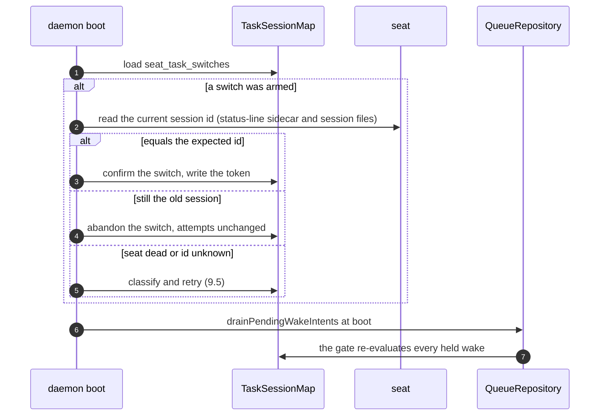

---

## 10. Call stacks

### 10.1 Creating a row

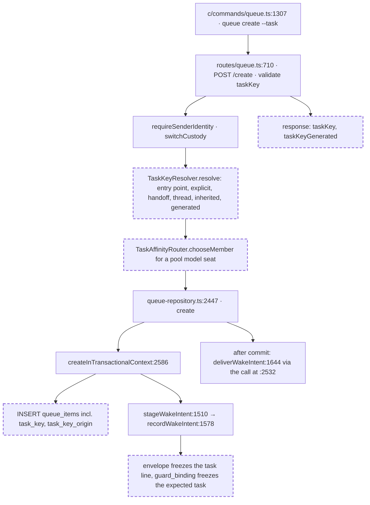

### 10.2 Delivering to a per-task seat

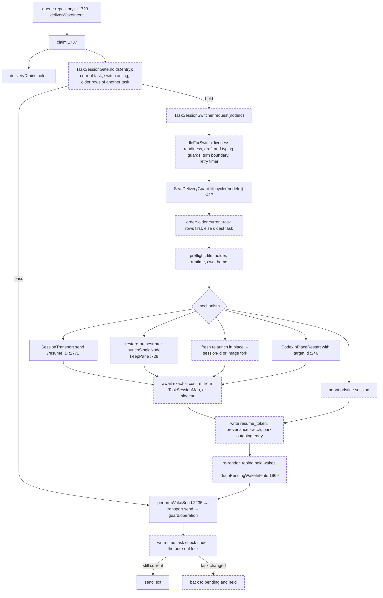

### 10.3 The hook updates the map

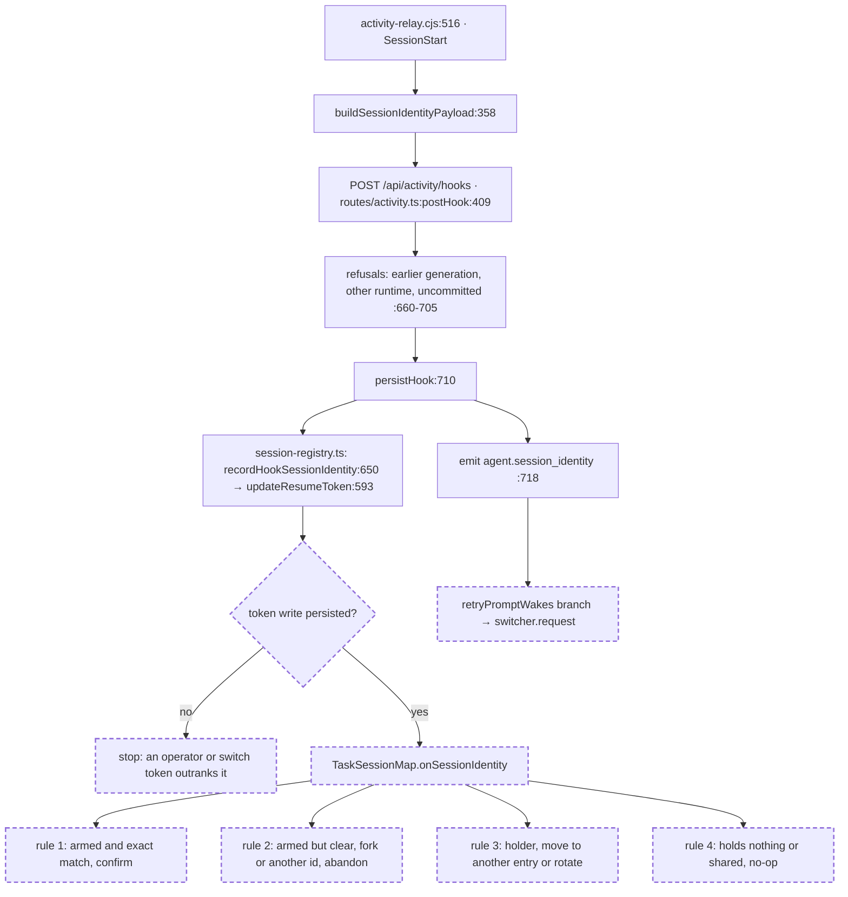

### 10.4 Claim

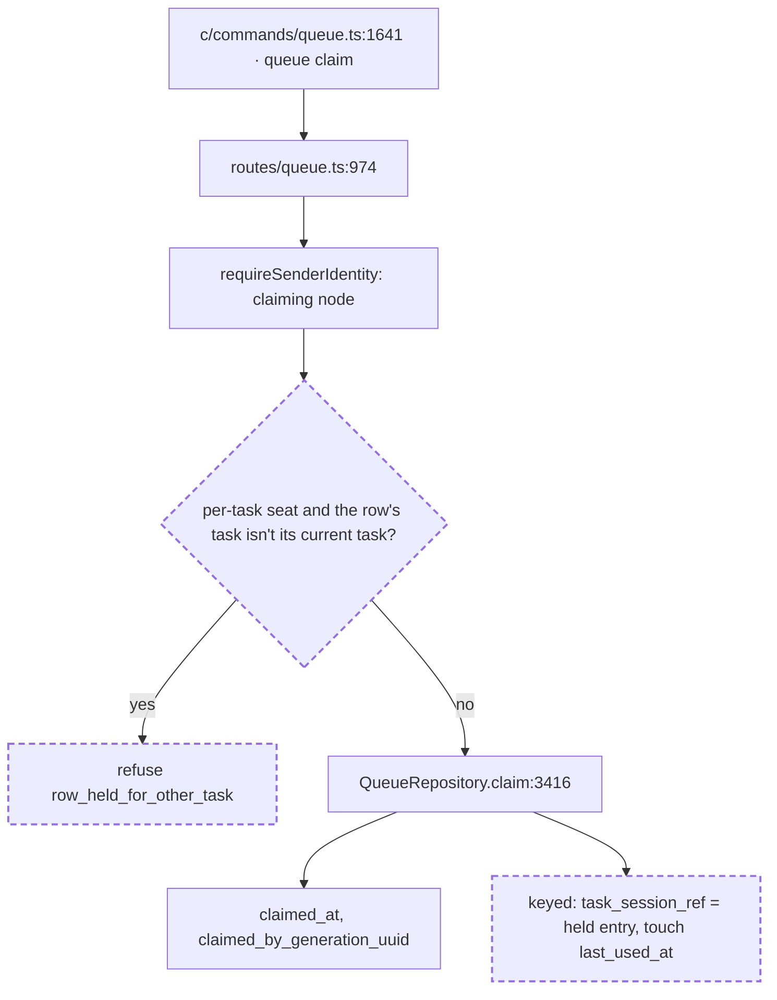

---

## 11. Changes by file

| Area | Files |
|---|---|
| Schema | `d/db/migrations/179_task_sessions.ts`, `d/db/all-migrations.ts`, test helper `test-app.ts` |
| Spec block | `d/domain/types.ts:1384`, `d/domain/rigspec-schema.ts` (`RIG_KEYS`, `MEMBER_KEYS`, `validateMember`, `normalizePod`, advisories), `d/domain/rigspec-codec.ts:179`, `d/domain/rigspec-exporter.ts`, `d/domain/rig-repository.ts` (`addNode`, setter and getter), instantiator re-apply sites |
| Cache window | Seat launch env (`seatLaunchEnvironment`, wired in `d/startup.ts`), the status-line collector (`prompt_cache` fields) |
| Rows and keys | `d/domain/queue-repository.ts` (`QueueCreateInput:438`, `createInTransactionalContext`, `stageWakeIntent` binding and envelope, `handoffWithin`, `handoffAndComplete`, `claim`, row map `:6545`, coalescing `:1789`, list filter), `d/routes/queue.ts`, `d/domain/queue-nudge-text.ts`, workflow step creators, `d/domain/gateway/slack/thread-seat-map.ts` and the Slack request path |
| Write-time check | `d/domain/session-transport.ts` (`sendClassifiedInput`, near the frozen-binding check at `:3124`), `d/domain/seat-delivery-guard.ts` |
| New modules | `d/domain/task-key-resolver.ts`, `d/domain/task-session-map.ts` (group entries, holders, rules 1–4, sweep), `d/domain/task-session-switcher.ts` (gate, order, idle, preflight, mechanisms, error classes, tries, drain, boot reconciliation), `d/domain/task-affinity-router.ts` (`chooseMember`, using `seat-pool-slots.ts`) |
| Mechanisms | `d/domain/seat-restart-in-place.ts` (target id), Claude fresh in-place relaunch (`successor-session-launcher.ts` or `seat-lifecycle-service.ts`), image fork (`claude-code-adapter.ts` fork branch) |
| Identity | `d/routes/activity.ts:persistHook`, `d/domain/session-registry.ts` (`switch` provenance), `d/domain/native-process-lineage.ts` (switch as rotation evidence), `d/startup.ts:retryPromptWakes` |
| Surfaces | `d/routes/seat.ts` (task sessions, retry, input-route refusal), `d/domain/node-inventory.ts`, `c/commands/seat.ts`, `c/commands/queue.ts` (flags, whoami and list marks, claim refusal), `c/commands/ps.ts` (`NodeEntry`, `ALLOWED_NODE_FIELDS`, compact projection, table), `c/mcp-server.ts` |
| Docs and skills | `docs/reference/rig-spec.md` (member and rig tables, a "Per-task sessions" section, validation), `docs/as-built/cli-reference.md`, `docs/reference/daemon-http-clients.md`, `docs/reference/seat-delivery.md`, the `queue-handoff` plugin skill (`--task`, `--task new`, recovery; then `npm run mirror-skills`) |

---

## 12. Tests

| Id | What | Layer |
|---|---|---|
| T-new | New key → pending entry, fresh session confirmed by exact id, held (§8.1) | Unit `task-session-switcher.test.ts` with a fake transport and launcher, plus stub scenario `per-task-switch` |
| T-resume | Known key → resume, and the first turn sees earlier context | Stub-runner work: per-session marker files, and the stub answers a typed `/resume ID` by switching marker and emitting SessionStart `resume`. Real Claude: status-line `prompt_cache.hit_ratio` or `cache_read_input_tokens` > 0 on the first turn after resume. Real Codex: rollout `token_count.cached_input_tokens` > 0. |
| T-keys | Entry-point first, explicit, handoff, thread, inherited, workflow and generated keys, `--task new` (A1–A9) | Unit `task-key-resolver.test.ts`, next to `return-route.test.ts` |
| T-notice | Internal notices stay keyless, including one that names the seat itself as sender | Unit, one per internal creator family |
| T-same | No key or same key, and seats not opted in, behave as on `main` | Unit pass-through. The existing delivery suites run unchanged. |
| T-race | A wake queued behind a switch fails the write-time check and goes back to held (F6). A typing-guard release gets the same check. | Unit on `sendClassifiedInput` with a fake guard chain |
| T-order | §7.4 ordering: older current-task rows first. A steady stream of current-task rows can't starve another task. | Unit on the switcher's order function |
| T-idle | No switch mid-turn, under the draft and typing guards, with an open prompt, held input, during a drain, or before the turn boundary. The start window releases a lost wake. | Unit idle-check matrix, plus a scenario with a row arriving during a scripted turn |
| T-pre | Preflight C2–C9 | Unit with a fake filesystem and map |
| T-act | D1–D12, E1–E5, error classes (§9.5), one-minute tries, escalation after the third | Unit with a scripted fake pane: picker, error text, no hook, sidecar, exit codes |
| T-claim | Claim refusal of another task's row, whoami/list marks, stamp | Unit on the route and the CLI |
| T-identity | Rules 1–4, exact-id confirm, child-process resume can't confirm, `switch` provenance beats an operator token | Unit on `onSessionIdentity` and `session-registry` |
| T-restart | Switch, kill the daemon while armed, boot reconciliation (§9.10), `rig up --existing` lands on the held task | Stub scenario `per-task-restart` |
| T-retention | 28-day default, Claude `L − 2` and cap at `L − 1` with an advisory, sweep skips held and armed entries | Unit with fake settings |
| T-cache | `cache_ttl` → launch env on fresh, restore and relaunch. Codex advisory. Effective window reported. Rig default plus member override. | Unit on launch env, plus `rigspec-schema` tests |
| T-pool | §7.11 rules 1–4, P1–P9 with fake `seat_pool_slots`, and `chooseMember` returning the model seat while no pool is armed | Unit on the router, plus a scenario with two stub slots |
| T-image | `agent_image` forks the seat's own `session_source` image at its pinned version, with a pre-generated id, and the image stays unchanged. The default resolves to `agent_image` on an image seat and to `restart` otherwise. `agent_image` without an image is a validation error on a member block and `restart` with an advisory from the rig default. Adopt only matches a launch of the same kind. C9 falls back to `restart`. | Unit on the mechanism. Scenario with a stub image. |
| T-migration | Parity and mirror | `migration-fixture-parity.test.ts`, `startup-migrations-mirror.test.ts` |

**Real-runtime check:** the delivery artery isn't stub-coverable (`arteries.md:76`). So PR 4 also states a manual run
of Appendix A's procedure inside a real OpenRig Claude seat. That run covers the `openrig-core` hooks through the
activity relay, and the typing-guard path delivering `/resume`.

---

## 13. Arteries touched (`docs/as-built/arteries.md`)

| Artery | Risk here | Past regressions to re-read |
|---|---|---|
| Delivery (`:37`) | The gate holds wakes, and the write-time check can send them back. A bug strands rows silently, so B3's visible hold reason matters. | mvschwarz/openrig#150, mvschwarz/openrig#197; exactly-one-target mvschwarz/openrig#109 → #141/#174/#188 |
| Launch/relaunch/resume (`:38`) | In-place fresh, image-fork and resume relaunches, plus the cache env | mvschwarz/openrig#154 (`CLAUDE_CONFIG_DIR`), mvschwarz/openrig#182 (readiness timeout) |
| Queue (`:39`) | New columns, key carry, claim refusal, list filter | mvschwarz/openrig#164 (stalled forever), mvschwarz/openrig#131 (host-qualification) |
| Native observation (`:42`) | A typed `/resume` and the switch-as-rotation evidence | Claude identity and conversation rotation |
| Migrations (`:43`) | Number collisions | Parallel PRs |
| Restore (`:44`) | Must still follow `resume_token`, now written with the `switch` provenance | mvschwarz/openrig#141 (stale pane ids), mvschwarz/openrig#116 |

Every PR here touches an artery, so each adds a stub scenario or says why it can't (`arteries.md:57`). Delivery and
restore have no scenario coverage today (`:76`, `:84`).

---

## 14. Open questions

1. **The error strings in §9.5** come from today's detectors, the spike and the runtimes' docs. New Claude and Codex
   versions will add more. Keep the classifier in one module, with a test per string.
2. **`fresh_start: agent_image`: which startup actions a fork launch replays.** The image's conversation should
   already hold the seat's guidance. Check that the fork path doesn't type it a second time. Also check which
   SessionStart `source` Claude and Codex report for a fork launch, so the pristine check for adopt matches it.
3. **Ordering by cache warmth** (spec Q4): out of scope. The data for it (`prompt_cache.expires_at`) is now recorded.
4. **ACP `--load-session`:** out of scope.

---

## 15. Delivery plan (one concern per PR)

1. **Keys on rows.** Migration (columns), key resolver (entry point, explicit, handoff, thread, inherited, generated),
   `--task`, `queue list --task`, MCP, the nudge's task line, the Slack thread mapping. No switching yet: a key
   changes nothing, but it's visible.
2. **The `sessions` block and the cache window.** Spec parse and validation (rig default plus override), `cache_ttl` →
   launch env, the effective window from the status line. Useful on its own, for any seat.
3. **The map and observation.** Tables, holders, hook rules 3–4, `switch` provenance, `rig seat sessions`, `ps`
   fields, claim stamp, retention sweep and caps.
4. **Switching for Claude.** Gate, order and affinity, write-time check, idle and guards, preflight, adopt, typed
   resume and fallback chain, fresh relaunch, rebind and drain, error classes and tries, escalation, claim refusal,
   boot reconciliation, rules 1–2, lineage evidence. Stub scenario `per-task-switch` plus the real-runtime check (§12).
5. **Switching for Codex,** plus workflow-run keys.
6. **Pool affinity.** `TaskAffinityRouter.chooseMember`, group-level holding across members, and the drain and add
   rules. If upstream's pool job is armed by then, it calls the router. If not, the router ships ready and returns the
   model seat.
7. **`fresh_start: agent_image`,** and the image-aware default. Until it lands, `fresh_start` accepts only `restart`,
   which is every seat's default.

---

## Appendix A. `/resume` spike

Run 2026-11-20 against a real Claude Code (2.1.312, Haiku 5.5, subscription login), interactive TUI in its own tmux
server and a scratch folder. Nothing was stubbed. SessionStart and Stop hooks were logged through `--settings`. The
table is the procedure, and it can be rerun with any Claude Code login.

| # | Step | Observed | Design consequence |
|---|---|---|---|
| 1 | Launch with `--session-id A` | SessionStart `startup`, id **A** | Pre-generated ids work, so a fresh relaunch is confirmed by exact id |
| 2 | Tell it "PINEAPPLE", then type `/clear` | SessionStart `clear`, new id **B** | `/clear` rotates the id. Rule 2 treats it as an intervention. |
| 3 | Tell B "MANGO", then type `/resume A` in the pane | SessionStart `resume`, id **A** (unchanged), about 4 s after Enter, no picker. Asked for the word: **PINEAPPLE**. | **Typed resume works:** same process, same id, context back. A 20 s ceiling leaves ample margin. |
| 4 | Type `/resume <unknown uuid>` | Inline `Session <uuid> was not found.` No hook. The current session stays active. | The D2 signal. Nothing is lost on failure. |
| 5 | Type `/resume B` | `resume`, id **B**, word **MANGO** | Switching back and forth works |
| 6 | A second process runs `claude --resume B` while the first still holds B | Accepted, no warning. SessionStart `resume`, id **B**. | **Claude doesn't stop two processes on one session.** Preflight C7 is required. |
| 7 | Two Ctrl-C, then type a command | Didn't exit (2.1.312). The command landed in Claude's prompt as text. | Never rely on Ctrl-C to stop a seat. OpenRig's `pane-cutover.ts` TERM/KILL is right. |
| 8 | Relaunch `claude --resume A` | `resume`, id **A**, word **PINEAPPLE** | The relaunch fallback keeps the id and context |
| 9 | Type `/compact` | SessionStart `compact`, id **A** (unchanged), word still recalled | Compaction doesn't rotate the id |
| 10 | Type `/exit` | Back to the shell | A clean stop |

**Extra fields on a `resume` hook:** `prompt_cache_likely_expired` (false in every run, since all were inside the
window), `seconds_since_last_response`, `context_tokens` and `estimated_cache_write_usd`.

**Not covered:** behaviour inside an OpenRig seat (the `openrig-core` hooks, and delivery through the typing guard)
and Codex. §12 covers both.

## Appendix B. Runtime facts (fetched 2026-11-20)

**Claude Code** (code.claude.com/docs: sessions, commands, hooks, cli-reference, settings, `.claude` directory,
prompt-caching, statusline, env-vars, errors):

- **Resume:**
  - `/resume [session]` takes an id or name and resumes directly; with no argument it opens the picker.
  - `--resume` / `/resume` keep the same id and append to the same transcript. `--fork-session` gives a new id.
  - `claude --resume BAD` prints `No conversation found with session ID: BAD` and exits 1. A failed in-pane resume
    leaves the current session running.
  - Resuming one session in two processes can lose messages.
- **SessionStart:** `source` is one of `startup`, `resume`, `clear`, `compact` or `fork`. Resume and fork carry
  `prompt_cache_likely_expired`. `/clear` starts a new session.
- **Transcripts:** stored at `~/.claude/projects/PROJECT/ID.jsonl`, where PROJECT is the cwd with non-alphanumerics
  replaced by `-`. `cleanupPeriodDays` defaults to 30 (minimum 1) and is swept globally after a session starts.
  `claude purge` deletes per project.
- **Prompt cache:**
  - Default: 1 h for the main conversation on a subscription within plan usage; 5 min on an API key, usage credits or
    Bedrock/Vertex. Subagents get 5 min.
  - Knobs: `CLAUDE_CODE_PROMPT_CACHE_TTL` (`5m`/`1h`), `promptCacheTtl`, `ENABLE_PROMPT_CACHING_1H`,
    `FORCE_PROMPT_CACHING_5M` (beats everything), `DISABLE_PROMPT_CACHING*`. Settable per process through the env or
    `--settings`.
- **Cache visibility:** the status line has `prompt_cache.{warm, ttl, expires_at, hit_ratio, misses, last_miss_cause}`
  (≥ 2.1.251) and `context_window.current_usage.cache_read_input_tokens`. The transcript's usage fields are internal.

**Codex CLI** (openai/codex source, OpenAI docs, issues):

- **Storage:** `$CODEX_HOME/sessions/YYYY/MM/DD/rollout-TS-THREADID.jsonl`, possibly `.jsonl.zst` or under
  `archived_sessions/`. Resolve by id, never by a cached path.
- **Lifetime:** no age-based deletion. Only `codex delete` / `/delete` removes a rollout. The `history.*` keys cover
  only the prompt-recall file.
- **Resume:**
  - `codex resume ID` keeps the id. An unknown UUID is fatal: "No saved session found with ID …".
  - A non-UUID is treated as a name, and `codex exec resume` with an unknown name silently starts a new thread. So
    always pass the UUID.
- **Non-resumable:** provider mismatch (`modelProviderMismatch`), an org or auth switch (`invalid_encrypted_content`),
  archived threads, rollout migrations.
- **Hooks:** `SessionStart` with `source` in startup, resume, clear, compact or fork, carrying `session_id` (the thread
  id).
- **Cache:**
  - No config key, env var or flag in 0.165.0. openai/codex#6698, asking for one, was closed as not planned.
  - An internal per-turn TTL (30m/12h) landed after 0.165.0 in openai/codex#59480, unexposed.
  - API defaults: in-memory on older models; 24 h for non-ZDR orgs on gpt-5.5; `ttl` 30m (default) or 12h on
    gpt-5.6+.
  - Cached tokens per turn are in the rollout's `token_count` events.
